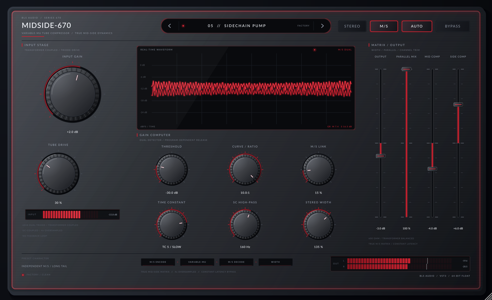

# MidSide-670

A JUCE 8 VST3 / Standalone variable-mu tube compressor inspired by the classic Fairchild 670, rebuilt around a **true Mid/Side matrix**. The centre and the stereo sides can be compressed independently, linked together, or run as a conventional linked L/R stereo compressor.



A dark brushed-gunmetal desktop unit under a flush, screwless glass overlay, with a crimson LED edge-glow, a top-centre pill readout, large machined knurled knobs, ultra-thin glass sliders and a central live waveform screen.

## Sound & architecture

- **Fairchild-style variable-mu curve** — soft-knee, level-dependent ratio and a dual-envelope, program-dependent release.
- **Six-position time-constant network** — from fast peak control to a long 10-second leveling tail.
- **True Mid/Side processing** — `M = (L + R) / 2`, `S = (L - R) / 2`; the matrix is decoded back with unity gain.
- **STEREO mode** — one linked detector drives both matrix channels, which is mathematically a linked L/R compressor. No image shift.
- **MID/SIDE mode** — independent Mid and Side gain computers with a continuously variable link control, plus per-channel compression trims.
- **Tube input stage** — asymmetric triode/transformer soft saturation with an 8 Hz DC blocker, running inside 4× oversampling.
- **Sidechain high-pass** — detector-only 12 dB/octave high-pass from 20–400 Hz, useful for keeping bass out of the M/S control voltage.
- **Parallel mix, stereo width, output gain, automatic make-up** — modern mix-bus conveniences.
- **Latency-matched bypass** — the dry signal travels through the same oversampling path, so bypass never changes the host-reported latency.

### Signal flow

```text
L/R in
  └─> input gain ─> 4× oversampled triode/transformer stage
        └─> M/S encode ─> sidechain high-pass ─> dual variable-mu gain computer
              └─> Mid Comp / Side Comp trims ─> M/S link
                    └─> stereo width ─> M/S decode ─> output gain
                          └─> parallel mix with latency-aligned dry
                                └─> 4× down-sample ─> L/R out
```

## Controls

| Control | What it does |
| --- | --- |
| **Input Gain** | Drive into the tube stage, ±18 dB. |
| **Tube Drive** | Amount of asymmetric valve/transformer saturation. |
| **SC High-Pass** | Detector-only high-pass. The audio path stays full-range. |
| **Matrix Mode** | `STEREO` (linked L/R) or `MID / SIDE` (independent centre/sides). |
| **Threshold** | Shared gain-computer threshold. |
| **Curve / Ratio** | Compression slope, 1.5:1 to 10:1. The variable-mu curve makes the effective ratio rise with drive. |
| **Time Constant** | Six Fairchild-style attack/release combinations, from `TC 1 / FAST` to `TC 6 / LEVEL`. |
| **M/S Link** | 0 % = fully independent Mid/Side; 100 % = one common detector level (the channel trims can still offset the two thresholds). Stereo mode forces 100 % and ignores the trims. |
| **Mid Comp / Side Comp** | Channel compression trim, ±12 dB. Positive values compress that channel more. Ignored in Stereo mode. |
| **Output Gain** | Post-matrix output trim, ±18 dB. |
| **Parallel Mix** | Blends the processed signal with the latency-aligned dry input. |
| **Stereo Width** | Post-compression Side level, 0–200 %. |
| **Auto Make-up** | Adds a conservative amount of make-up related to threshold. |
| **Bypass** | Hard bypass with constant reported latency. |

### Metering

The central obsidian waveform screen shows the live post-processing signal as a three-layer glowing crimson trace over a dB/time grid, together with the current **MID** and **SIDE** gain reduction (or the linked **L/R** value in Stereo mode). A slim glass input strip sits under the input stage, and the footer carries a compact L/R output meter with peak-hold ticks and a clip bead.

## Factory presets

| # | Name | Character |
| --- | --- | --- |
| 01 | M/S Init | Clean start, true Mid/Side |
| 02 | 670 Legacy Glue | Linked stereo, slow variable-mu |
| 03 | Mid/Side Vocal Air | Open centre, detailed sides |
| 04 | M/S Drum Room | Hard sides, punchy centre |
| 05 | Sidechain Pump | Independent M/S, long tail |
| 06 | Parallel Tube Crush | Transformer grit, fast |
| 07 | Mix-Bus 670 | Gentle glue, wide window |
| 08 | Mono Bass Anchor | Centre weight, slow release |
| 09 | Widescreen Strings | Soft sides, untouched centre |
| 10 | Broken Radio | Saturated, squashed, small |

Presets are exposed as host programs and also selectable from the top pill readout: click the name for the preset menu, or use the `<` / `>` chevrons to step through the factory library.

## Build

The project uses JUCE 8.0.8 and C++17. On this Linux workstation the offline JUCE checkout and rootless dev sysroot are reused from the sibling `plugin_poc` cache:

```bash
./scripts/setup-linux.sh
./scripts/build.sh
```

The build produces:

```text
dist/MidSide-670.vst3
dist/MidSide-670                  # Standalone
build/MidSide670Tests_artefacts/Release/MidSide670Tests
build/MidSide670HostSmokeTest_artefacts/Release/MidSide670HostSmokeTest
build/MidSide670Screenshot_artefacts/Release/MidSide-670 Screenshot
```

On a machine without the offline cache, CMake falls back to `FetchContent` for JUCE 8.0.8. On Linux install the usual JUCE dependencies (`libasound2-dev`, X11 development headers, FreeType, Fontconfig) first.

### Verification

```bash
./scripts/build.sh
./build/MidSide670Tests_artefacts/Release/MidSide670Tests
./build/MidSide670HostSmokeTest_artefacts/Release/MidSide670HostSmokeTest dist/MidSide-670.vst3
DISPLAY=:0 "./build/MidSide670Screenshot_artefacts/Release/MidSide-670 Screenshot" --out=dist/midside670-ui.png
```

The offline tests cover matrix unity, time-constant ordering, gain-reduction response, independent vs linked detection, 4× oversampling, finite audio, bypass latency, lock-free waveform telemetry, and state restoration. The host test scans the built VST3 bundle, instantiates it, runs audio, checks all programs, and round-trips host state.

## Install

Copy `dist/MidSide-670.vst3` to your VST3 folder:

- Linux: `~/.vst3/`
- macOS: `~/Library/Audio/Plug-Ins/VST3/`
- Windows: `C:\Program Files\Common Files\VST3\`

The Standalone build can be launched directly from `dist/MidSide-670`.

## CI / releases

`.github/workflows/build.yml` builds and tests Windows x64, Linux x64 and macOS Universal (`arm64` + `x86_64`) binaries, packages VST3 + Standalone distributions with SHA-256 checksums, and publishes them to GitHub Releases for `v*` tags or a manual `workflow_dispatch` release tag.

## Notes

MidSide-670 is an original design inspired by the behaviour of classic variable-mu compressors. It is not affiliated with, endorsed by, or a model of any particular vintage hardware manufacturer. Fairchild is a trademark of its respective owner. The bundled Lato typefaces are licensed under the SIL Open Font License; see `Resources/Lato-OFL.txt`.
